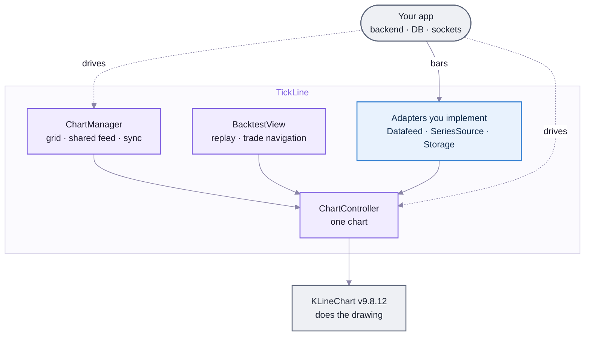

# TickLine — in one page

**Start here.** What TickLine is, how the parts fit, and the rules it keeps. Names are defined in [glossary.md](glossary.md); the full design is in [ARCHITECTURE.md](ARCHITECTURE.md).

> [!NOTE]
> **TickLine in 30 seconds.** A TypeScript charting library built on KLineChart v9. Your app gives it bars through a small `Datafeed` interface and drives it through a `ChartController`. Out of the box you get candles, ~27 built-in indicators, drawing tools, trade markers and position boxes, multi-chart grids with TradingView-style sync, bar replay, and a Jupyter widget. It knows nothing about any backend or market. QuantPrime is its first user, but it's built to be released publicly.

---

## The picture

Your app talks to TickLine in two directions: it **supplies data** through adapters and **gives commands** to a `ChartController` (or to a `ChartManager` for a grid). TickLine turns both into KLineChart calls.

---

## The parts (each named once)

| Part | Job | Detail |
|---|---|---|
| **`ChartController`** | One chart. Every command (set symbol, add indicator, draw, show trades) goes through it. | [API §4](API.md) |
| **Adapters** | `Datafeed` (bars, required), `SeriesSource` (host-computed indicators, optional, not built yet), `Storage` (saving layouts, optional). | [API §3](API.md) |
| **Built-in indicators** | ~27 standard indicators computed by KLineChart in the browser. No backend. | [ARCHITECTURE §4](ARCHITECTURE.md) |
| **Drawings** | Trend line, ray, horizontal/vertical line, rectangle, fib, text. Saved and restored as JSON. | [API §4.5](API.md) |
| **Trade annotations** | Buy/sell markers, TradingView-style position boxes, level lines (PDH/PDL). | [API §4.6](API.md) |
| **`ChartManager`** | A grid of charts: one live feed per symbol, every timeframe derived from 1m, seven sync switches. | [CHARTMANAGER.md](CHARTMANAGER.md) |
| **`BacktestView`** | A ready-made backtest viewer: chart, bar replay, jump between trades. | [API §6.6](API.md) |
| **Delivery** | npm package (ESM + CJS), `tickline/react`, a standalone browser bundle, and the `tickline-widget` Python package for Jupyter. | [README](../README.md) |

---

## One chart, start to finish

1. You implement a `Datafeed`: `getBars(symbol, period, from, to)` for history and `subscribe(...)` for live bars.
2. `createChart(el, { datafeed, timezone: "Asia/Kolkata" })` makes a `ChartController`.
3. `setSymbol("NIFTY")` and `setPeriod("5m")` fetch a window of bars ending at the newest one, then subscribe for live bars.
4. `addIndicator("EMA", "main", [20, 50])`: KLineChart computes it in the browser.
5. The user scrolls left; TickLine fetches the previous window by itself.
6. The user draws a trend line; TickLine emits `drawingCreated`, and you save `chart.serialize()` wherever you like.
7. `setMarkers` / `setPositions` show your strategy's trades. Each appears only once its bar is loaded, which is also what makes replay work.

---

## The rules that never break

1. **Bars are always UTC epoch ms.** The display timezone changes only how times are shown (D-T5).
2. **TickLine depends on no consumer and no market.** Anything specific to one app or exchange stays in that app's adapter (D-T1).
3. **The `Datafeed` always delivers bars, never raw ticks.** Tick→bar building is the adapter's job; `BarBuilder` helps (ARCHITECTURE §2).
4. **Adapters never throw synchronously, and TickLine never retries.** Errors arrive on one `error` channel with a `retryable` flag (ARCHITECTURE §10).
5. **Multi-chart sync is keyed by timestamp, never bar index**, and syncs the time window, not the zoom (D-CM4).
6. **Only draw an annotation while its bar is loaded.** KLineChart clamps unloaded points to the data edge ([KLINECHART_MAPPING](KLINECHART_MAPPING.md#v9-engine-facts-dont-re-discover)).
7. **KLineChart stays pinned at `9.8.12`.** Engine edge cases are TickLine's to handle (D-T3).

---

## What TickLine does *not* do (yet)

- **No host-computed indicators.** Tier-2 `plotSeries` (multi-timeframe and strategy-matched indicators) is designed but not built.
- **No advanced drawing tools.** The ~60 custom tool families (Gann, pitchfork, volume profile…) are v1.5 (D-T2).
- **No engine swap and no multi-language SDK.** That was the original idea, dropped by D-T1 ([archive/spike.md](archive/spike.md)).

Two scope questions are open (Q-T1, Q-T2 in [DECISIONS.md](DECISIONS.md#open-not-decided)): whether the backtest toolkit and Python widget are core, and whether milestones should use package versions.

## Where things stand

v1 core is built: 79 TypeScript tests and 7 Python tests pass. Details and next steps: [PROGRESS.md](PROGRESS.md).

## Read next

[glossary.md](glossary.md) → [ARCHITECTURE.md](ARCHITECTURE.md) → [API.md](API.md) (when you're writing code) → [CHARTMANAGER.md](CHARTMANAGER.md) (for grids).
