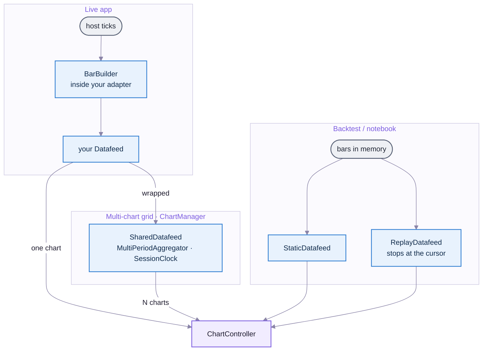

# TickLine — Glossary

One name per thing. If a doc uses a name that isn't here, or two names for one thing, fix the doc. Checked against `src/` on 2026-10-04.

---

## How bars reach a chart (the most confusing part)

There is one interface, `Datafeed`, and several things that implement or wrap it. Which path the bars take depends on what you're building.

- **Live, one chart:** your adapter → `ChartController`. If your source sends ticks, `BarBuilder` turns them into bars inside the adapter.
- **Live, a grid:** `ChartManager` wraps your adapter in a `SharedDatafeed`, which subscribes once per symbol at 1m and derives every other timeframe.
- **Backtest:** `StaticDatafeed` serves bars you already have; `ReplayDatafeed` serves them only up to a moving cursor. `BacktestView` picks between them.

---

## Core objects

| Name | What it is | Code |
|---|---|---|
| **`ChartController`** | One chart. The object a host drives. Made by `createChart(el, options)`. | `src/ChartController.ts` |
| **`ChartManager`** | A grid of `ChartController`s with a shared feed and sync. | `src/ChartManager.ts` |
| **`SyncController`** | Replays crosshair, drawings, clicks and date ranges between charts. `ChartManager` creates and attaches it; on a bare chart, `linkGroup`/`syncConfig` do nothing. | `src/SyncController.ts` |
| **`BacktestView`** | A ready-made viewer: one chart, a Chart\|Replay toolbar, trade navigation. The Jupyter widget mounts this. | `src/BacktestView.ts` |
| `react` entry | `<TickLineChart>`, a thin React wrapper around `ChartController`. | `src/react.tsx` |

## Data feeds and bar building

| Name | What it is |
|---|---|
| **`Datafeed`** | The interface a host implements: `getBars(symbol, period, from, to)`, `subscribe(symbol, period, onBar)`, and optional `getRange()`. Always delivers **bars**. |
| Bounded feed | A `Datafeed` with `getRange()`: its data ends somewhere in the past (history, backtest, replay). The chart opens at its end instead of "now" and can page newer bars. |
| **`StaticDatafeed`** | A bounded feed over bars held in memory. `barsFromColumns()` converts columnar data. |
| **`ReplayDatafeed`** | A bounded feed whose data stops at a cursor you move with `play/step/seek`. `attachReplay()` keeps a chart in step. |
| **`SharedDatafeed`** | Wraps a host feed so N charts on one symbol share one upstream subscription. Made by `createSharedDatafeed()`; `ChartManager` uses it. |
| 1m spine | The rolling buffer of recent 1m bars per symbol inside `SharedDatafeed`, from which every other timeframe is derived (D-CM5). |
| **`BarBuilder`** | Turns ticks into bars for one period. UTC-floored, or anchored at the session open if given a `session`. |
| **`MultiPeriodAggregator`** | Turns one 1m stream into bars for many periods, provisional while forming and rebuilt from 1m on close (D-CM2). |
| **`SessionClock`** | Works out which bucket a timestamp falls in, counted from the session open. No session means a UTC floor. |
| `periodToMs` | `"17m"` → 1 020 000. Any `<int><s|m|h|d|w>`. |
| `MockDatafeed`, `QuantPrimeDatafeed` | Example host adapters in `demo/`, not part of the library. QuantPrime's: [integrations/quantprime.md](integrations/quantprime.md). |

## Indicators

| Name | Meaning |
|---|---|
| **Tier 1 / built-in** | A standard indicator KLineChart computes in the browser (`addIndicator("EMA")`). |
| **Tier 2 / series** | A host-computed line plotted with `plotSeries`, delivered by a **`SeriesSource`**. For multi-timeframe, strategy-matched or custom indicators. Not built. |
| `SeriesSpec` | What to compute: symbol, indicator, params and the indicator's own timeframe. |
| Confirmed / provisional | A series point from a closed bar vs one from a bar still forming. Backtests use confirmed only. |
| Forward-filled | A higher-timeframe series repeats its last closed value on every base bar, so a 15m EMA on a 1m chart is a staircase. |

## Drawings, annotations and layouts

| Name | Meaning |
|---|---|
| **Drawing** | Something the user draws (trend line, fib…). Editable, emits `drawingCreated/Modified/Removed`, saved by `serialize()`. |
| **Trade annotation** | A marker, position box or level line set by code (`setMarkers`, `setPositions`, `setLevels`). Not editable, not saved, survives `clearDrawings()`. |
| Overlay | KLineChart's word for anything drawn on top of candles; both drawings and annotations are overlays. |
| `TradeLayer` | Draws each annotation only while its bar is loaded. |
| `tlMarker`, `tlPosition`, `tlLevel`, `rect` | TickLine's custom overlays (`src/overlays.ts`). |
| Linked cursor | The dashed crosshair TickLine draws on other charts during sync (`setCrosshair`). |
| `LayoutSnapshot` | What `serialize()` returns: drawings, panes, series specs and the visible range. Never series data. |
| `GridSnapshot` | `ChartManager.serializeLayout()`: symbol, period and `LayoutSnapshot` per cell. |
| Pane | A horizontal region of a chart. `"main"` holds candles; sub-panes hold RSI, MACD, volume. |

## Time

| Name | Meaning |
|---|---|
| `Bar.ts` | Bar open time in **UTC epoch ms**. Never shifted. |
| Display timezone | How times are *shown* (`timezone` option, `setTimezone`). Default UTC. |
| **`SessionSpec`** | Trading hours: `{ tz, days, sessions: [{start, end}] }`, e.g. NSE 09:15–15:30 IST. Absent means 24h. |
| Session-anchored | Buckets counted from the session open, so NSE 1h bars start at 09:15, 10:15… |

## Sync flags (`SyncConfig`)

| Flag | Scope | Effect |
|---|---|---|
| `symbol` / `interval` | whole grid | Change one chart's symbol or period, change all. Off by default. |
| `crosshair` / `drawings` / `indicators` | same-symbol charts | Linked cursor; replicated drawings; replicated indicator definitions. |
| `time` | whole grid | Click a bar and the other charts scroll to that time. |
| `dateRange` | whole grid | Every chart shows the same time window. |
| Echo suppression | — | A chart receiving a synced change doesn't send it back out. |

## Delivery

| Name | Meaning |
|---|---|
| npm build | `dist/`: ESM + CJS + types. KLineChart is a peer dependency. |
| Standalone bundle | `dist/standalone/tickline.global.js`: one script tag, KLineChart included, global `TickLine`. |
| **`tickline-widget`** | The Python package in `python/`: `TickLineChart` for Jupyter, built on anywidget. |

## Versions and ids

| Name | Meaning |
|---|---|
| **v1** (TickLine) | Today's core: single chart, built-in indicators and tools, grid, backtest toolkit. |
| **v1.5** (TickLine) | The ~60 custom drawing tools, `screenshot`, `setPrecision`. **Not the same as QuantPrime's v1.5** (live trading). Renaming is open: Q-T2. |
| D-T, R-T, D-CM, Q-T | Decision families: what TickLine is, API questions, the grid, open questions. All in [DECISIONS.md](DECISIONS.md). |
| 🔲 | In scope but not built; calling it emits a `series` error. |
